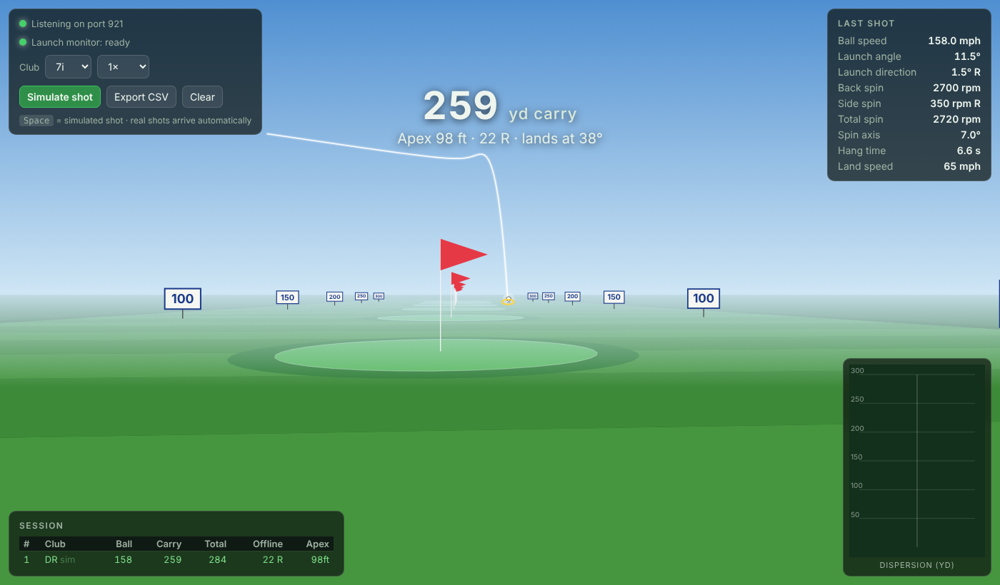

# Teebox

A simple, lightweight driving range visualizer for the launch monitor you already own.



Hit a ball, watch it fly. Teebox receives shot data from your launch monitor, plays back the
ball flight, and shows carry, total distance, offline, apex and a session history. It is one small
Node.js program with **no dependencies**, no account, no subscription, and it runs fine on an old laptop.

It speaks the **GSPro Open Connect** protocol on TCP port 921, so it works with any launch monitor
(or community connector) that can send shots to a GSPro-style listener.

## Features

- Ball flight animation with a broadcast-style camera, carry callout, then total distance with roll
- Last-shot panel: ball speed, launch angle and direction, back/side/total spin, spin axis, hang time, landing speed, angle and spin
- Physics-based ball flight: lift and drag from spin ratio and Reynolds number, spin decay, and a friction-based bounce and roll
- Playing conditions: temperature, altitude, humidity, wind and turf firmness all change the flight
- Session table, dispersion map, club tagging, CSV export
- Built-in "Simulate shot" mode so you can try it with no hardware
- Works offline. Nothing leaves your machine
- Pure Node.js (18+) and a single HTML page. No build step, no `npm install`

## Quick start

Install [Node.js](https://nodejs.org) (LTS), then:

**Windows:** double-click `start.bat`. Your browser opens to http://localhost:3000.

**macOS / Linux:** `npm start`, then open http://localhost:3000.

Click **Simulate shot** (or press Space) to try it without a launch monitor.

## Connect your launch monitor

### SkyTrak (tested)

Verified working with an **original SkyTrak** (USB) running **SkyTrak app 5.4.12**, using the community connector
[OpenSkyPlus2](https://openskyplus2.github.io/OpenSkyPlus2/README-OpenSkyPlus2.html). It also lists SkyTrak+ and ST Max.
OpenSkyPlus2 is a separate project and is not included here. Follow its install guide, then use this order:

1. Start Teebox (`start.bat` / `npm start`). Wait for "Listening on port 921".
2. Make sure GSPro is **not** running. Only one program can use port 921.
3. Plug in the SkyTrak while it is off, then turn it on.
4. Launch SkyTrak from the **"SkyTrak (Admin)"** shortcut that OpenSkyPlus2 creates, and choose USB Mode.
5. The "Launch monitor" light in Teebox turns green. Hit a shot.

### Other launch monitors

Anything that can send shots to a GSPro Open Connect listener at `127.0.0.1:921` should work. This is
untested on other hardware. Reports and fixes are welcome (see [Contributing](CONTRIBUTING.md)).

### Settings

Set with environment variables, or pass the Open Connect port as the first argument (`node server.js 2483`):

| Variable   | Default   | Meaning                                                        |
|------------|-----------|----------------------------------------------------------------|
| `OC_PORT`  | `921`     | TCP port that listens for launch monitor shots                 |
| `WEB_PORT` | `3000`    | Port for the browser view                                      |
| `HOST`     | `0.0.0.0` | Interface to listen on. Use `127.0.0.1` to keep it local only  |

## Try it without hardware

Send a fake shot to a running instance:

```
curl -X POST http://localhost:3000/api/shot -d "{\"BallData\":{\"Speed\":120,\"VLA\":16,\"HLA\":1,\"BackSpin\":6500,\"SideSpin\":300}}"
```

(On Windows use `curl.exe` in Command Prompt or PowerShell.)

## How it works

```
Launch monitor ──USB──> vendor app + connector ──TCP :921 (JSON)──> server.js ──SSE──> browser
                                                                                      (physics + drawing)
```

- `server.js` listens for Open Connect JSON, replies `{"Code":200,...}`, and pushes each shot to the page over Server-Sent Events.
- `public/physics.js` simulates the flight, bounce and roll from the launch data. The model is described in [docs/PHYSICS.md](docs/PHYSICS.md).
- `public/index.html` draws the range on a plain 2D canvas with its own small perspective camera.

Open Connect shot fields used: `BallData.Speed` (mph), `VLA`, `HLA` (degrees, right is positive),
`BackSpin` and `SideSpin` (rpm), or `TotalSpin` with `SpinAxis` if those are missing.
Club data is ignored. Spec: https://gsprogolf.com/GSProConnectV1.html

## Accuracy

The launch data comes from your launch monitor. The ball flight is Teebox's own physics model: gravity,
drag and spin lift computed from the ball's speed, its spin and the air it flies through, then a bounce and
roll on turf. It is not a lookup of typical distances, so it handles a thin 7-iron or a low-spin drive the
same way it handles a good one.

- Carry is within about 3 yards on average of TrackMan's published PGA and LPGA Tour numbers for every club
  from driver to wedge, and within 2 yards on average of 175 reference shots from 55 to 135 mph that were
  not used to build the model.
- The driver is the weakest club: about 6 yards short of the tour average.
- Roll-out is an estimate. It depends on the turf preset you pick, and real fairways vary more than that.
- Expect carry to differ a little from your monitor's own software. Each uses its own ball model.

Open **Conditions** in the top-left panel to set temperature, altitude, humidity, wind and turf. They are
remembered in your browser. [docs/PHYSICS.md](docs/PHYSICS.md) has the equations, the sources, the full
comparison table and the known limits.

## Troubleshooting

- **"Launch monitor" light stays red:** nothing has connected to the port yet. Check that the connector is running,
  that it points to `127.0.0.1` and the same port, and that you started Teebox first.
  Windows may need an inbound firewall rule for TCP 921.
- **"Port 921 is already in use":** GSPro or another copy of Teebox is running. Close it, or run
  `node server.js 2483` and set the same port in your connector.
- **Shots arrive but look wrong:** open the connector's log and compare its numbers with the last-shot panel.

## Development

```
npm test      # physics checks against tour data + protocol tests, no dependencies
npm start
```

## Roadmap ideas

- Real 3D scene, more ranges and targets
- Per-club averages and shot filtering
- Save and compare sessions
- Support for more launch monitor protocols

## Similar projects

Teebox aims to stay tiny: one Node file, one HTML page, no dependencies. If you want something bigger, these
open source projects cover related ground (check each one for how actively it is maintained):

- [OpenFairway](https://github.com/digitalhand/openfairway): Godot golf sim with a detailed, calibrated C# ball physics addon. Its approach inspired Teebox's physics model
- [OpenShotGolf](https://github.com/jhauck2/OpenShotGolf): Godot golf sim with a driving range mode and a GSPro Open Connect listener
- [Open-Birdie](https://github.com/jordan-shilts/Open-Birdie): Electron + Three.js course simulator driven by any Open Connect launch monitor
- [openGS](https://github.com/dmyoung1994/openGS): browser-based Three.js golf simulation with its own physics engine
- [PiTrac](https://github.com/PiTracLM/PiTrac) and [OpenFlight](https://github.com/open-flight/openflight): open source DIY launch monitors that can feed Teebox

## Disclaimer

Teebox is an independent project. It is not affiliated with, endorsed by, or sponsored by SkyTrak,
GSPro, OpenSkyPlus2, or any launch monitor maker. All product names are trademarks of their owners and
are used only to describe compatibility.

## License

[MIT](LICENSE)
